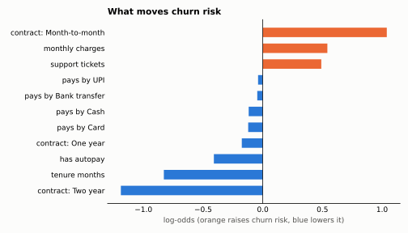

# Customer churn prediction

A logistic regression that scores how likely each customer is to leave and puts them in a low, medium or high risk band. I did churn work like this during my internship at NanoBi Analytics, where it was part of a proof of concept that helped win a client. This is a cleaned-up version on synthetic telecom-style data.

The model matters less than the output. A retention team can't do much with a probability, but they can work through a list of high-risk customers and see why each one is on it.



## The data

5,000 made-up customers with tenure, monthly charges, support tickets, contract type, payment method and whether they pay by autopay. Churn is generated so it depends on those in a believable way: short contracts and lots of tickets push it up, autopay and long tenure pull it down.

## Results from a run

- ROC-AUC of 0.81 on the 25% held out for testing
- recall of 0.76 on churners and precision of 0.68. I weighted the classes so the model leans towards catching churners, because for retention a missed churner costs more than one extra call
- of the 1,250 test customers, 463 land in the high band, 404 in medium and 383 in low

Month-to-month contracts are the biggest single driver, then monthly charges and support tickets. Two-year contracts and longer tenure protect the most.

## Running it

```bash
pip install -r requirements.txt
python churn_model.py
```

It writes `churn_scores.csv`, one row per test customer with their probability and band, plus the chart above. At work a file like this would feed a Power BI page that the retention team filters by band.

## What I'd change with real data

The bands use fixed cut-offs at 0.3 and 0.6. With a real team I'd set them based on how many customers they can actually call in a week. I'd also compare against a tree model, though logistic regression is far easier to explain to a business audience, and that mattered more here.
